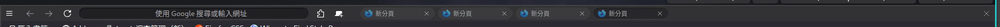
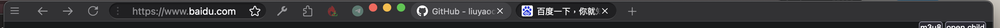
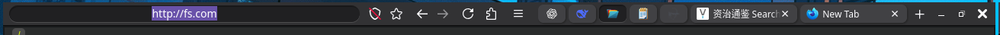
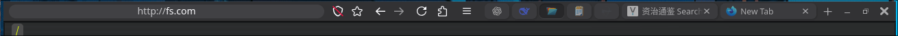
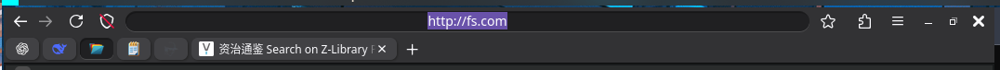
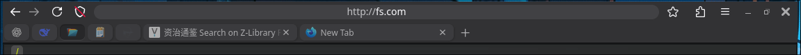

# firefox-theme

## ~~000-my~~

- linux 
- macos 

> 参照: `https://github.com/datguypiko/Firefox-Mod-Blur.git` 

## ~~001-topbar~~

## 01

- 
- 
- 
- 

# install

1. browser `about:config`
2. set `toolkit.legacyUserProfileCustomizations.stylesheets=true`
3. browser `about:support`, open **Profile Directory**
4. `cp ./* ${Profile Directory}/chrome/` and `cd ${Profile Directory}/chrome/`
5. run `./select 02`
6. restart firefox

# 关于火狐

## 配置文件相关

见 `https://support.mozilla.org/zh-CN/kb/%E7%AE%A1%E7%90%86%E7%94%A8%E6%88%B7%E9%85%8D%E7%BD%AE%E6%96%87%E4%BB%B6#w_start-the-profile-manager-when-firefox-is-closed`

运行 `firefox -P` 重新初始化

# 获得窗口源码

1．打开 Browser Toolbox
    - 先在 about:config 开：
    ```
    devtools.chrome.enabled = true
    devtools.debugger.remote-enabled = true
    ```
    - 然后重启 Firefox。
2. 菜单(三横杠) → 更多工具(More Tools) → 浏览器工具箱(Browser Toolbox)

# source code build

1. 打开 https://firefox-source-docs.mozilla.org/contributing/directory_structure.html
2. 点击 “the repository”： https://firefox-source-docs.mozilla.org/contributing/contribution_quickref.html#firefox-contributors-quick-reference
3. Download the “MozillaBuild Package”: https://ftp.mozilla.org/pub/mozilla/libraries/win32/MozillaBuildSetup-Latest.exe
4. 打开exe程序